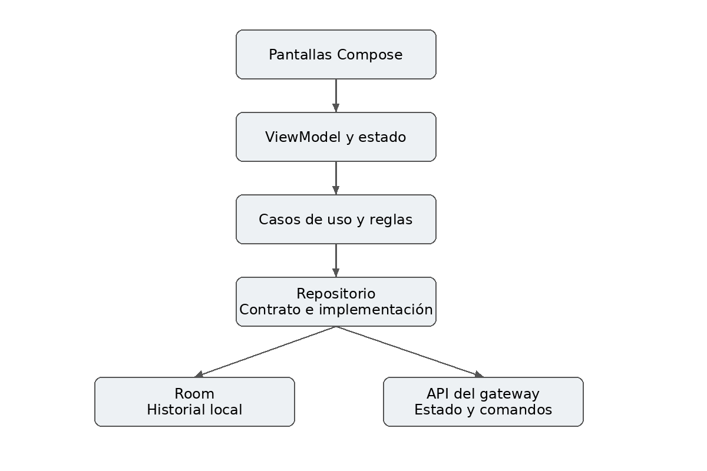
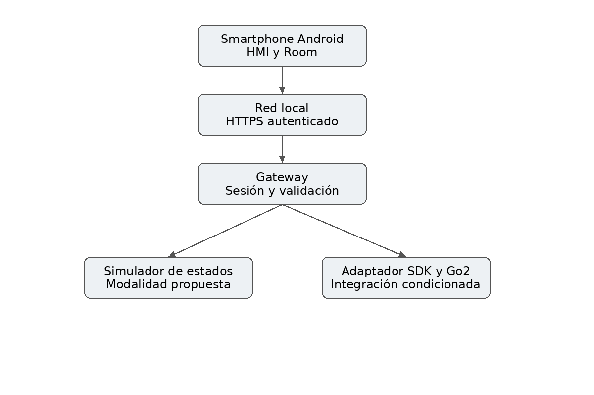
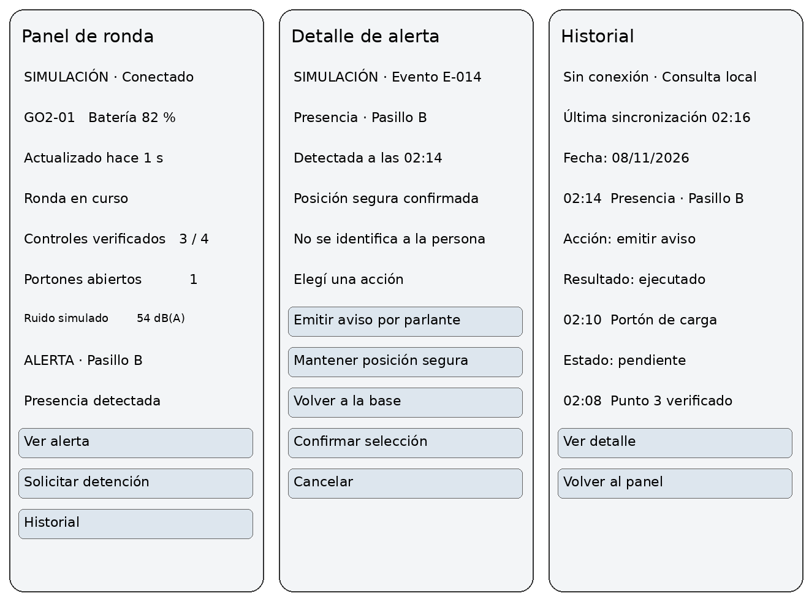

# RondaGo

**Supervisión móvil de patrullaje nocturno en depósitos logísticos con un Unitree Go2.**

Trabajo práctico grupal de Desarrollo de Aplicaciones I (UADE, Facultad de Ingeniería y Cs. Exactas): interfaz HMI/HRI para un robot de servicio, con prototipo en Figma y una app Android que funciona con un robot simulado.

> **Estado:** diseño propuesto (preentrega). No hay todavía código, pruebas ejecutadas ni integración con un robot real. El diseño completo está en [`docs/preentrega.md`](docs/preentrega.md).

## El problema

Las rondas de seguridad a pie en un depósito son caras y las cámaras fijas tienen puntos ciegos entre estanterías. Cuando el registro es manual, además, cuesta reconstruir qué puntos se revisaron y cómo se respondió a una alerta. El costo y la frecuencia de incidentes todavía no fueron medidos: son hipótesis a validar con un responsable de seguridad.

## La solución

Una app Android para que un operador supervise una ronda robótica del Go2: ve el progreso, los accesos abiertos y el ruido, recibe alertas, responde a una presencia detectada y consulta el historial aunque no haya conexión.

- **Un depósito, un robot (GO2-01), una ruta y un operador con autoridad de control.**
- **Ruta:** base, recepción, pasillo A, pasillo B y portón de carga (4 puntos de control fuera de la base).
- **Variables propias:** puntos verificados, accesos abiertos y ruido ambiente.
- **Escenario propio:** presencia en un sector restringido (pasillo B). El operador elige entre emitir un aviso por parlante, mantener posición segura o volver a la base. No se guardan imágenes, rostros ni audio: el historial registra solo el evento.

## Cuatro flujos funcionales

| Requisito | Qué permite |
| --- | --- |
| RF01 Supervisar una ronda | Consultar la ruta, iniciar o pausar, y ver estado y progreso |
| RF02 Consultar variables y alertas | Ver puntos verificados, accesos, ruido y alertas con su vigencia |
| RF03 Responder a una presencia | Elegir una acción y ver su estado: solicitado, aceptado, ejecutado |
| RF04 Consultar historial persistente | Revisar rondas y eventos, también sin conexión |

## Decisiones de diseño

- **Solicitar no es ejecutar:** cada orden tiene un `commandId` y estados separados (solicitado, aceptado, ejecutado, rechazado, fallido, vencido o resultado desconocido). La falta de respuesta nunca se transforma en éxito.
- **Sin cola offline de órdenes:** sin enlace o con datos vencidos, las órdenes se bloquean. El historial recibido sí queda disponible localmente.
- **La detención desde la app es un comando de software simulado:** no reemplaza una parada física de emergencia.
- **Modo simulado siempre rotulado** como SIMULACIÓN. Las funciones no disponibles se deshabilitan con explicación.
- **ROS2 y DDS solo como referencia de diseño**, no como dependencia del APK. El contrato de mensajes es propio y no es el protocolo oficial de Unitree.

## Arquitectura

Kotlin y Jetpack Compose con MVVM (ViewModel y StateFlow), casos de uso en el dominio, un Repository que desacopla el origen de los datos, Room para el historial, Retrofit para hablar con el gateway, Navigation Compose, DataStore y Coroutines. La inyección de dependencias es manual.

| Capa | Contenido |
| --- | --- |
| Presentación | Pantallas Compose y ViewModels |
| Dominio | Modelos, reglas y contratos de repositorio |
| Datos | Room (historial local) y API del gateway (estado y comandos) |
| Gateway y simulador | Validación de órdenes, autoridad de control y eventos reproducibles |

## Contenido del repositorio

| Ruta | Qué contiene |
| --- | --- |
| [`docs/preentrega.md`](docs/preentrega.md) | Documento de preentrega completo: problema, actores, alcance, requisitos, telemetría, comandos, arquitectura, persistencia, pruebas, riesgos y guía de defensa |
| [`docs/img/`](docs/img) | Bocetos de pantallas, flujo y diagramas de arquitectura |

Estructura prevista para el código: `app/presentation`, `app/domain`, `app/data`, `gateway`, `simulator` y `docs`.

## Bocetos

Son propuestas visuales estáticas con datos sintéticos, no el prototipo nativo de Figma.

## Estado y próximos pasos

- [x] Documento de preentrega (borrador)
- [ ] Completar integrantes, legajos, comisión, docente y fecha
- [ ] Prototipo navegable en Figma (flujo normal y flujo con falla)
- [ ] Confirmar con el docente si el simulador es aceptado como backend funcional
- [ ] Confirmar capacidades del Go2 y nombres de tópicos en la documentación oficial de Unitree
- [ ] Gateway, simulador y app con los cuatro flujos
- [ ] Pruebas P01 a P14 y evidencias de los cinco escenarios
- [ ] Entrega final: APK, código, diagrama de arquitectura, ejemplos JSON, evidencias y video de demostración

## Cómo ejecutarlo

Pendiente: se completará cuando exista código (requisitos de ejecución, configuración de red, modo simulado y datos de prueba). No se guardan credenciales en el repositorio.
