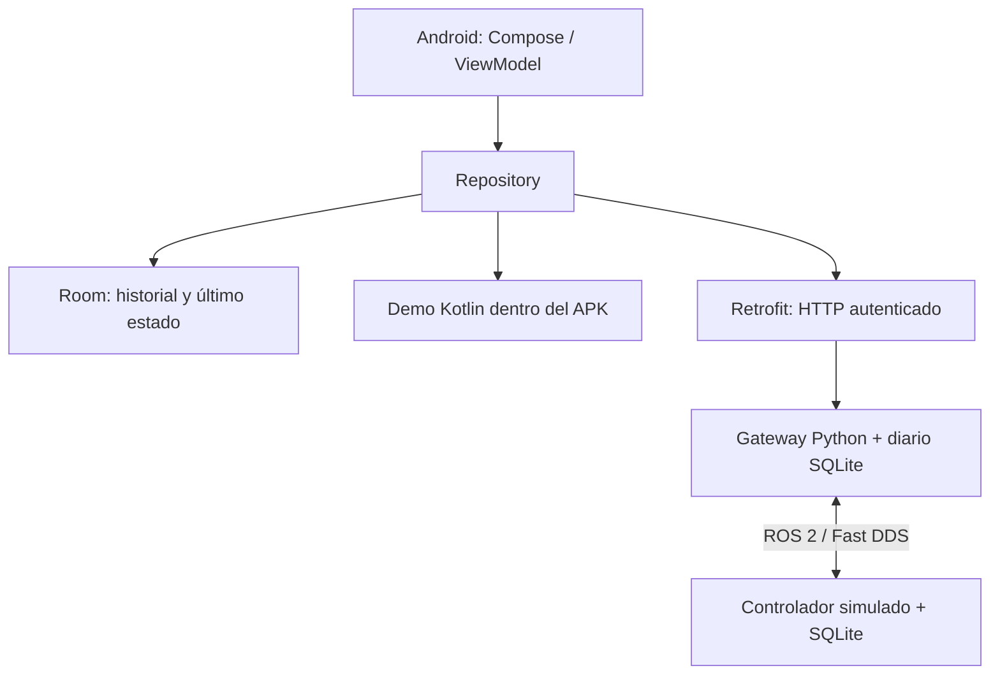

# Implementación del prototipo

## Arquitectura



La app utiliza estado observable StateFlow, coroutines, almacenamiento Room y preferencias DataStore. Un observador del ciclo de vida suspende las consultas de supervisión cuando la actividad deja el primer plano. La inyección es manual. La navegación se resuelve con cuatro pestañas Compose, sin Navigation Compose: no se requieren enlaces profundos en este prototipo.

El controlador ROS y el gateway son procesos separados. Usan `std_msgs/msg/String` con JSON propio del TP, QoS reliable/volatile y profundidad 10. No son los tipos ni el protocolo de Unitree. La telemetría se publica a 1 Hz y después de comandos. El estado incluye eventos, rondas y resultados para reconciliar tras reconexión. Este snapshot completo es simple y adecuado para la demo; un despliegue prolongado requeriría paginación y retención para no crecer indefinidamente.

## API v1

Todas las rutas requieren `Authorization: Bearer <RONDAGO_TOKEN>`. Token mínimo de 16 caracteres, configurado fuera del repositorio. HTTP de laboratorio, sin TLS. El token es compartido: no constituye identidad personal de cada operador.

| Método/ruta | Cuerpo o consulta | Resultado |
| --- | --- | --- |
| GET `/v1/state` | — | Última telemetría, `fresh`, `hasTelemetry`, `receivedAt`, `ageSeconds`, `transport` |
| POST `/v1/control-session` | `clientId` | `id`, `clientId`, `expiresAt`; renueva al mismo cliente |
| POST `/v1/commands` | `id`, `action`, `eventId`, `note`, `expectedVersion`, `sessionId` | HTTP 202 y resultado conocido; consultar el resultado posterior |
| GET `/v1/commands/{id}` | — | ACCEPTED, EXECUTED, REJECTED o UNKNOWN; 404 si el diario no conoce el ID |
| GET `/v1/events?after=0` | Cursor entero >=0 | Hasta 200 eventos actualizados y próximo cursor |

El cursor avanza tanto para eventos nuevos como para cambios de estado. La app actual obtiene la lista completa desde `/state` y aplica upserts por ID en Room; el endpoint de cursor queda disponible para evolución incremental.

Ejemplo de orden (usar versión y sesión actuales, no copiar identificadores):

```json
{"id":"UUID-unico","action":"START","eventId":"","note":"","expectedVersion":0,"sessionId":"sesion-vigente"}
```

Acciones: START, PAUSE, RESUME, CANCEL, RETURN, STOP, ACK, RESOLVE, ANNOUNCE, HOLD y acciones DEMO_* visibles en el panel. Todos los escenarios de inyección exigen control y datos vigentes. El servidor verifica las precondiciones; no confía solo en los botones deshabilitados.

## Confirmación y reconexión

1. Android guarda REQUESTED localmente y deshabilita envíos concurrentes.
2. El gateway valida sesión, vigencia, versión y lista de acciones; guarda ACCEPTED antes de transmitir.
3. El controlador verifica TTL y versión, aplica la transición y guarda estado + resultado en una transacción SQLite.
4. El resultado llega por la telemetría ROS. El gateway lo concilia y Android lo consulta.
5. Si no llega, se muestra UNKNOWN. El gateway reentrega **el mismo ID con el mismo TTL**: si fue ejecutado devuelve el resultado persistido; si nunca llegó y venció, lo rechaza. No se crea otra orden para repetir la acción.

Un reinicio del controlador pausa una ronda activa y conserva los resultados. Un reinicio del gateway invalida sesiones, carga su diario y espera telemetría nueva. Si nunca vuelve el controlador, no se puede saber el resultado y las órdenes permanecen bloqueadas. Esto es intencional.

## Persistencia y privacidad

Android guarda eventos, rondas, comandos y último snapshot en Room, separados por modo/URL. No almacena rostros, imágenes, audio ni identidad de personas detectadas. El campo libre de resolución es texto ingresado por el operador; usar descripciones operativas sin datos personales. El token queda solo en memoria, no en DataStore. El backend usa SQLite local, no una nube compartida.

## Límites de esta entrega

- Simulación lógica de datos; no física 3D, navegación, percepción ni control Unitree.
- El aviso por parlante confirma una operación simulada; no reproduce audio real.
- No hay servicio Android en segundo plano ni notificaciones de incidentes con app suspendida.
- No se certifican latencias de seguridad, emergencia física ni eficacia para vigilancia.
- Figma, integrantes/legajos y aprobación académica del alcance deben ser aportados por el equipo. Los bocetos conservados son imágenes, no un prototipo navegable de Figma.
- La red Windows/WSL/teléfono depende de la instalación del usuario; las pruebas automatizadas usan procesos en un mismo host y un emulador.
