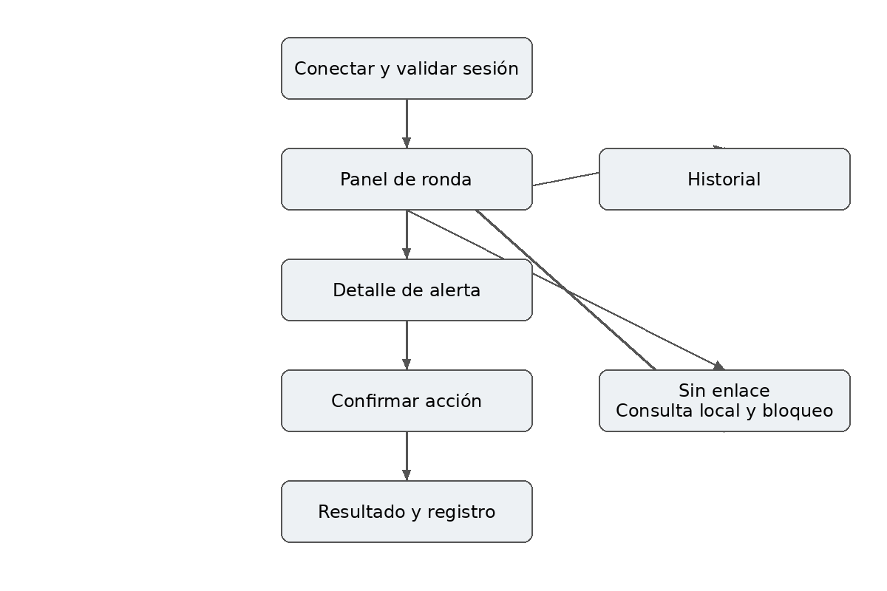
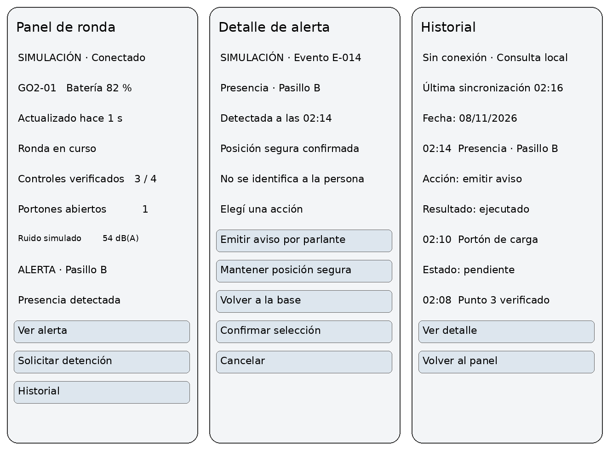
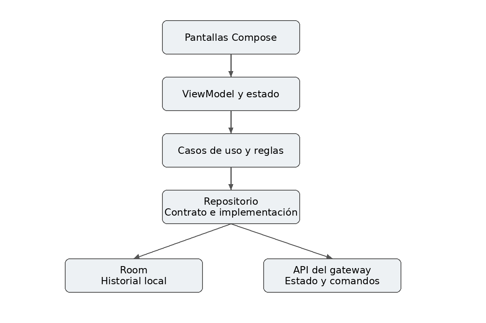
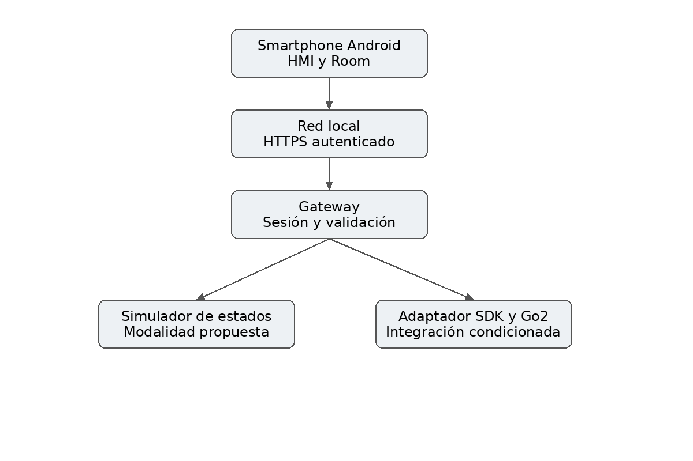

# RondaGo

**Supervisión móvil de patrullaje nocturno en depósitos logísticos**

Preentrega de análisis y diseño · Desarrollo de Aplicaciones I · UADE · 2026

Propuesta de aplicación Android para supervisar un robot Unitree Go2, consultar controles y gestionar alertas durante las rondas nocturnas.

## Propósito del documento

Este documento desarrolla la propuesta para la primera etapa del TP. Incluye el problema, usuarios, actores, alcance, elección del robot, requisitos verificables, comandos, telemetría, experiencia de uso, arquitectura, persistencia y estrategia de implementación. Los anexos aportan bocetos, pruebas previstas y una guía para la defensa.

El alcance prioriza cuatro flujos funcionales. La aplicación podrá trabajar con un servicio simulado de eventos y comandos; su aceptación como modalidad de entrega debe acordarse con el docente. La conexión a un Go2 real depende del modelo, firmware, SDK y equipamiento efectivamente disponibles.

## Datos de la entrega

| Dato | Completar por el equipo |
| --- | --- |
| Integrantes y legajos | [Completar] |
| Comisión y docente | [Completar] |
| Fecha de entrega | [Completar] |
| Repositorio | https://github.com/feliforte14/TP-HMI-ROBOT |
| Diseño en Figma | [Agregar enlace al prototipo] |

**Estado:** diseño propuesto. No se presentan entrevistas, ahorros, pruebas ejecutadas ni integración física como resultados ya obtenidos.

## Índice

1. [Problema y contexto de uso](#1-problema-y-contexto-de-uso)
2. [Solución y propuesta de valor](#2-solución-y-propuesta-de-valor)
3. [Alcance y viabilidad](#3-alcance-y-viabilidad)
4. [Telemetría, variables y reglas del dominio](#4-telemetría-variables-y-reglas-del-dominio)
5. [Requisitos funcionales y comandos](#5-requisitos-funcionales-y-comandos)
6. [Calidad, seguridad y privacidad](#6-calidad-seguridad-y-privacidad)
7. [Escenario principal e interacción humana](#7-escenario-principal-e-interacción-humana)
8. [Flujo de pantallas](#8-flujo-de-pantallas)
9. [Bocetos para el prototipo en Figma](#9-bocetos-para-el-prototipo-en-figma)
10. [Tecnologías y arquitectura](#10-tecnologías-y-arquitectura)
11. [Infraestructura y contrato de integración](#11-infraestructura-y-contrato-de-integración)
12. [Persistencia y estrategia offline](#12-persistencia-y-estrategia-offline)
13. [Organización e implementación](#13-organización-e-implementación)
14. [Plan de pruebas y evidencias](#14-plan-de-pruebas-y-evidencias)
15. [Riesgos y decisiones pendientes](#15-riesgos-y-decisiones-pendientes)
16. [Guía para la defensa](#16-guía-para-la-defensa)
17. [Lista de entrega y fuentes](#17-lista-de-entrega-y-fuentes)

---

## 1. Problema y contexto de uso

### Situación problemática

En un depósito logístico, el personal de seguridad necesita verificar pasillos, portones y sectores restringidos durante el turno nocturno. Las estanterías pueden limitar la visibilidad de las cámaras fijas y obligar a realizar recorridos presenciales para comprobar el estado de determinados puntos.

La solución habitual combina cámaras y rondas a pie. Entre una verificación y la siguiente pueden pasar inadvertidos un acceso abierto o una presencia inesperada. Además, cuando los registros se realizan de forma manual, resulta difícil reconstruir qué puntos se revisaron y cómo se respondió a una alerta.

RondaGo propone concentrar la supervisión de una ronda robótica y su registro en el celular del operador. Se trata de un escenario académico plausible que requiere validación con un responsable de seguridad. La frecuencia real de incidentes, los puntos ciegos y el costo de las rondas todavía no fueron medidos.

### Entorno

El robot opera de noche en un depósito de una sola planta, con poca luz y sin personal en la mayor parte del recorrido.

- **Zonas:** muelle de carga con portones, pasillos entre estanterías, sector restringido y base de carga.
- **Condiciones:** piso liso, maquinaria apagada o en espera, y obstáculos temporales como pallets mal ubicados.
- **Conectividad:** Wi-Fi irregular entre estanterías metálicas, por lo que la app debe tolerar datos viejos y desconexiones.

### Actores

El operador de seguridad es el único que usa la aplicación; los demás actores condicionan el diseño de la HMI y de la interacción con el robot (HRI).

| Actor | Rol | Necesidad | Implicancia para la HMI |
| --- | --- | --- | --- |
| Operador de seguridad (supervisor del turno nocturno) | Opera la app | Ver el estado, iniciar y pausar rondas, resolver incidentes | Estado y acción inmediata visibles sin explorar menús |
| Personal nocturno ocasional | Comparte el espacio con el robot | Entender qué hace el robot y que no es un peligro | Intención del movimiento legible: aviso sonoro y luminoso |
| Persona no autorizada | Puede ingresar en un sector restringido | Es el evento a detectar | Detección sin grabar ni identificar a la persona |
| Responsable del depósito | Consulta el historial | Evidencia de cada ronda sin datos personales | Registro de eventos, no de imágenes |

### Usuario principal

Operador de seguridad del turno nocturno. Necesita conocer el estado de la ronda, detectar situaciones pendientes y decidir una respuesta comprensible. Se supone que tiene manejo básico de un smartphone y recibe capacitación sobre la operación del sistema. Utiliza la aplicación durante consultas breves y ante alertas, varias veces por turno.

### Condiciones de uso

El operador puede desplazarse por el establecimiento y encontrar cobertura Wi-Fi irregular entre estanterías. La iluminación reducida y la atención compartida con otras tareas requieren controles legibles, pocos pasos y mensajes claros. Las maniobras que exijan atención continua deben realizarse con el operador detenido y concentrado en la tarea.

### Necesidad y criterio de éxito

La necesidad central es saber qué se verificó, qué requiere atención y si una orden realmente se ejecutó. El éxito del prototipo se comprobará completando una ronda de prueba, atendiendo una alerta y recuperando su historial sin conexión, con evidencia de cada transición.

### Validación propuesta

Antes de fijar el diseño definitivo, entrevistar a un responsable de seguridad y a un operador. Preguntar cómo planifican las rondas, qué accesos deben estar cerrados, dónde falla la conexión, cómo registran novedades y qué respuesta esperan ante una presencia. Documentar fecha, rol y consentimiento. No incorporar respuestas ficticias como evidencia.

## 2. Solución y propuesta de valor

### Descripción de RondaGo

Aplicación Android para supervisar una ruta predefinida de patrullaje, consultar puntos de control, recibir alertas de accesos y ruido, y responder a una presencia detectada. El robot o simulador informa su estado a un gateway; la aplicación presenta la información y envía solicitudes validadas.

### Misión

El robot hace una ronda por una lista de puntos de control y en cada uno verifica el estado del entorno: accesos, ruido y presencia de personas.

1. El operador inicia la ronda desde la app y el robot sale de la base.
2. En cada punto de control se registra la llegada y el punto se marca como verificado cuando el controlador lo confirma.
3. Si se detecta una anomalía, se emite una alerta; si es una presencia, el controlador interrumpe el avance y se espera una decisión del operador.
4. Al terminar, o si el operador lo pide y las condiciones lo permiten, el robot vuelve a la base de carga.

El robot detecta y avisa; no abre portones ni interviene físicamente.

### Por qué una aplicación móvil

El operador puede alejarse del puesto central y continuar consultando la ronda desde el teléfono. Las notificaciones y la vibración ayudan a advertir una alerta, mientras que el almacenamiento local permite revisar el historial en sectores sin cobertura. No se utilizará el GPS del teléfono para ubicar al robot dentro del depósito.

### Elección del robot

Elegimos el Unitree Go2 porque la tarea es recorrer y observar, no manipular objetos, y un cuadrúpedo cubre pasillos angostos de forma estable. No se demuestra que sea la alternativa más económica; eso requiere comparar costos y condiciones reales.

| Alternativa | A favor | En contra |
| --- | --- | --- |
| Sin robot (guardia y cámaras fijas) | Sin desarrollo ni equipamiento nuevo | Costo de personal nocturno y puntos ciegos entre estanterías |
| Unitree Go2 (cuadrúpedo) | Estable, de bajo perfil, recorre pasillos y terreno irregular | No tiene brazos: no abre ni cierra portones |
| Unitree G1 (humanoide) | Puede manipular objetos | Más complejo y costoso para una tarea que no requiere manos |

**Capacidades a confirmar en la ficha oficial:** LiDAR, cámara, IMU, parlante, autonomía de batería de aproximadamente 1 a 2 horas y marcha sobre terreno irregular.

**Lo que requeriría desarrollo adicional:** navegación autónoma con mapa del depósito, detección de personas y detección de accesos abiertos. En el TP estas capacidades se simulan (ver la tabla de capacidades en la sección 3).

### Valor esperado

La propuesta busca mejorar la trazabilidad de los controles y facilitar la respuesta supervisada. El beneficio económico es una hipótesis: debe compararse el costo total de adquisición, integración, mantenimiento y operación con el esfuerzo evitado. No se asume el reemplazo de personal ni una reducción comprobada de incidentes.

| Problema | Usuario | Solución | Valor esperado |
| --- | --- | --- | --- |
| Controles dispersos y visibilidad parcial | Operador nocturno | Supervisión de ruta y alertas en Android | Registro consultable y decisiones trazables |

### Indicadores para una prueba piloto

| Indicador | Cálculo o medición |
| --- | --- |
| Cobertura de ronda | Puntos verificados / puntos planificados × 100. |
| Tiempo de atención | Hora de decisión del operador menos hora de recepción de alerta. |
| Alertas falsas | Alertas descartadas tras revisión / alertas revisadas. |
| Órdenes confirmadas | Órdenes con ejecución confirmada / órdenes emitidas. Separar las de resultado desconocido. |
| Costo por ronda | Costo total del período / rondas completadas. Requiere datos reales. |

Los indicadores se evaluarán contra una línea de base del depósito. Los datos del simulador demostrarán funcionamiento, pero no permitirán afirmar mejoras en seguridad o rentabilidad real.

## 3. Alcance y viabilidad

### Primera versión

Un depósito, un robot identificado como GO2-01, una ruta predefinida y un operador con autoridad de control. Se incluyen supervisión de la ronda, visualización de tres variables propias, tratamiento de una presencia y consulta del historial local. El mapa será un plano esquemático con sectores, no un sistema de navegación desarrollado desde cero.

### Recorrido de la ronda

La ruta propuesta es: base, recepción, pasillo A, pasillo B y portón de carga. Se verifican cuatro puntos fuera de la base. El pasillo B es el sector restringido donde se produce el escenario de presencia.

```
 Base ──▶ Recepción ──▶ Pasillo A ──▶ Pasillo B ──▶ Portón de carga
  ▲                                  (sector restringido:         │
  │                                   pausa si hay presencia)     │
  └──────────────────── regreso a la base ◀───────────────────────┘
```

### Fuera de alcance

Reconocimiento facial, identificación automática de intrusos, persecución, intervención física, apertura de portones, múltiples robots, teleoperación continua por joystick, reconstrucción tridimensional, entrenamiento de modelos de visión y despliegue comercial. Tampoco se promete una función de emergencia certificada desde el teléfono.

### Modalidad de implementación

La modalidad base propuesta utiliza un simulador de estados conectado al gateway. Genera rondas y eventos reproducibles, valida comandos, cambia estados y persiste resultados. No consiste solamente en navegar pantallas. La integración física es una ampliación condicionada a la aprobación del docente y a la verificación del equipo.

| Capacidad | Implementación inicial | Confirmación para Go2 real |
| --- | --- | --- |
| Puntos de control | Eventos de llegada simulados | Localización y señal verificable de llegada. |
| Acceso abierto | Evento con identificador de acceso | Sensor de apertura o percepción integrada. |
| Ruido ambiente | Lectura sintética rotulada | Sensor y calibración; no asumir dB reales. |
| Presencia | Evento sintético por sector | Detector externo o integrado y política de privacidad. |
| Aviso por parlante | Resultado simulado explícito | Salida de audio y API accesibles. |
| Volver a base | Transición simulada con confirmación | Navegación, mapa y retorno disponibles. |

La interfaz mostrará siempre SIMULACIÓN cuando corresponda. Las funciones no disponibles se deshabilitarán con explicación. No se atribuyen estas capacidades de aplicación al Go2 por el solo hecho de disponer de un SDK.

### Criterio de cierre del alcance

Antes de programar la integración, registrar modelo, firmware, versión del SDK, sensores, comandos probados y responsable de laboratorio. Si falta una capacidad, mantener la simulación aprobada o reducir el alcance y documentar el cambio.

## 4. Telemetría, variables y reglas del dominio

### Telemetría completa

La app muestra las ocho variables que pide la consigna del TP más las tres variables propias del servicio. Todo dato lleva su hora de última actualización y se marca como viejo si la conexión se pierde.

| Variable | Qué muestra | Origen |
| --- | --- | --- |
| Conectividad | Conectado, degradado o desconectado | Consigna |
| Batería | Porcentaje y advertencia de nivel bajo | Consigna |
| Estado operativo | Estado de la ronda (preparada, en curso, pausada, regresando, finalizada o interrumpida) | Consigna |
| Misión y progreso | Ronda en curso y puntos completados | Consigna |
| Ubicación | Punto de control actual o sector | Consigna |
| Movimiento | Quieto, avanzando o detenido en posición segura | Consigna |
| Alertas | Lista de alertas pendientes, atendidas y resueltas | Consigna |
| Última actualización | Hora de la última lectura recibida | Consigna |
| Puntos verificados | Contador x/N y listado con estado y hora | Propia |
| Accesos abiertos | Acceso, sector, estado y hora | Propia |
| Ruido ambiente | Valor, unidad, origen y hora | Propia |

### Reglas de las variables propias

| Variable | Definición y presentación | Regla de registro |
| --- | --- | --- |
| Puntos verificados | Contador x/N y listado con estado y hora | Verificado solo al recibir confirmación del controlador. Visitar el sector no basta si falta la validación prevista. |
| Accesos abiertos | Acceso, sector, estado y hora | Alertar si figura abierto cuando su configuración exige cerrado. No duplicar cada lectura del mismo episodio. |
| Ruido ambiente | Valor, unidad, origen y hora | En demo usar valor sintético. En operación real usar dB(A) solo con medición adecuada y calibrada. |

### Parámetros de demostración

Ruta propuesta: base, recepción, pasillo A, pasillo B y portón de carga. Se verifican cuatro puntos fuera de la base. Una nueva ronda reinicia el conteo, pero conserva el historial de rondas anteriores.

Para ruido simulado se propone una alerta al superar 70 dB(A) sintéticos durante 3 segundos y recuperación bajo 65 durante 5 segundos. Estos valores sirven para probar persistencia e histéresis; no son límites normativos ni criterios validados para un depósito. Evitar que el propio parlante genere una nueva alerta acústica: identificar esa ventana de emisión.

Las muestras incluirán `source`, `observedAt` y `receivedAt`. Para la demo, una lectura con más de 5 segundos sin actualización se marca como desactualizada y bloquea nuevas solicitudes operativas. Este tiempo es un parámetro de prueba, no una garantía de seguridad física.

### Batería baja

La consigna del TP exige demostrar un escenario de batería baja. Se propone una advertencia visible cuando la batería simulada cae por debajo de un umbral configurable, que el equipo debe definir; no se fija un valor normativo. La advertencia ofrece la acción de volver a la base (si hay navegación disponible) y bloquea el inicio de nuevas rondas hasta recuperar un nivel suficiente.

### Reglas complementarias

Una ronda tiene estados preparada, en curso, pausada, regresando, finalizada o interrumpida. Solo se permite una ronda activa por robot. Una alerta pasa de pendiente a atendida cuando existe una decisión registrada; puede continuar sin resolución física. Cerrar una alerta requiere una confirmación o una justificación del operador.

Un comando tiene un identificador único. Su estado puede ser solicitado, aceptado, ejecutado, rechazado, fallido, vencido o resultado desconocido. La falta de respuesta nunca se transforma automáticamente en éxito.

En ausencia de comunicación no se permite iniciar ni reanudar una ronda. El regreso a base tampoco se ejecuta como reacción universal a una falla: necesita navegación disponible y condiciones seguras verificadas.

## 5. Requisitos funcionales y comandos

### RF01 Supervisar una ronda

Usuario: operador. Permite consultar la ruta, solicitar inicio o pausa y observar estado, progreso y controles realizados. Precondiciones para iniciar: sesión de control válida, gateway accesible, telemetría vigente y capacidad habilitada.

**Aceptación:** dada una ruta con cuatro controles, al recibir tres confirmaciones distintas se muestra 3/4; repetir una confirmación no aumenta el contador. El inicio queda pendiente hasta que el controlador confirme el estado en curso. Si rechaza la solicitud, se explica el motivo.

### RF02 Consultar variables y alertas

Usuario: operador. Presenta puntos verificados, accesos abiertos, ruido y sus marcas temporales. Las alertas se relacionan con una ronda y un sector; la pantalla distingue pendiente, atendida y resuelta.

**Aceptación:** al inyectar apertura del portón configurado como cerrado, aparece una alerta con su identificación. Repetir el mismo `eventId` no la duplica. Si no llegan muestras durante más de 5 segundos en la demo, se indica dato desactualizado. Si no hay lecturas, se muestra sin datos, nunca cero como valor supuesto.

### RF03 Responder a una presencia detectada

Usuario: operador con control. Ante una presencia puede solicitar un aviso por parlante, mantener posición segura o volver a base. Cada opción indica su efecto y disponibilidad. Antes del envío se confirma la acción seleccionada.

**Aceptación:** dado un evento de presencia, al confirmar una acción se crea un único `commandId` vinculado al evento y se muestra solicitado. Una respuesta de aceptación no muestra ejecutado. Solo una confirmación posterior actualiza el resultado a ejecutado. Sin conexión, la acción queda bloqueada y no se encola para más tarde.

### RF04 Consultar historial persistente

Usuario: operador. Consulta rondas y eventos por fecha, tipo o estado, junto con la acción elegida y su resultado conocido. La información recibida se conserva localmente para consulta offline.

**Aceptación:** después de recibir una alerta y su respuesta, cerrar y abrir la aplicación sin red conserva el registro. En una instalación sin datos locales se muestra el estado vacío. Al reconectar se incorporan eventos faltantes sin duplicar los ya registrados.

### Trazabilidad

RF01 se demuestra con una ronda. RF02 con aperturas, ruido y datos vencidos. RF03 con una presencia y resultados alternativos. RF04 con reinicio de la aplicación, desconexión y recuperación del historial.

### Catálogo de comandos

La app ofrece siete órdenes discretas, sin joystick. Cada una tiene una condición de habilitación, una respuesta simulada y un estado visible.

| Comando | Se habilita cuando | Confirmación previa |
| --- | --- | --- |
| Iniciar ronda | Sesión de control válida, gateway accesible, telemetría vigente, capacidad habilitada, batería suficiente y sin otra ronda activa | No |
| Pausar ronda | Hay una ronda en curso | No |
| Reanudar ronda | La ronda está pausada, hay comunicación y no hay incidente sin resolver | No |
| Cancelar ronda | Hay una ronda en curso o pausada | Sí, por su impacto |
| Solicitar regreso a punto seguro (volver a base) | El robot está fuera de la base y hay navegación y condiciones seguras verificadas | Sí, antes del envío |
| Solicitar detención | Hay enlace con el gateway; el botón está siempre visible y se informa el estado de entrega | Sí, por su impacto |
| Reconocer alertas | Hay una alerta pendiente; pasa a atendida al registrar una decisión | No; cerrarla exige confirmación o justificación |

La detención es un comando de software simulado y no reemplaza una parada física de emergencia. Una orden enviada tampoco equivale a una orden ejecutada: la app muestra su estado hasta que el robot responde.

### Estados de una orden

La consigna del TP pide cuatro estados visibles; el modelo interno de RondaGo es más fino. La correspondencia es esta:

| Estado visible (consigna) | Estado interno (RondaGo) |
| --- | --- |
| Pendiente | Solicitado |
| Confirmada | Aceptado (recepción validada) y ejecutado (con evidencia posterior del controlador) |
| Rechazada | Rechazado por el gateway y fallido |
| Sin respuesta | Vencido y resultado desconocido |

## 6. Calidad, seguridad y privacidad

| ID | Requisito verificable propuesto |
| --- | --- |
| RNF01 Usabilidad | Acceso al detalle de alerta desde el panel en un toque; texto y símbolos además del color; controles táctiles de al menos 48 dp. |
| RNF02 Accesibilidad | Etiquetas para lector de pantalla y prueba con texto al 200 % sin ocultar acciones principales. |
| RNF03 Rendimiento | En dispositivo y red de prueba documentados, 95 de 100 eventos recibidos se reflejan en pantalla en menos de 2 s desde su recepción local. |
| RNF04 Vigencia | Sin actualización durante más de 5 s en demo, indicar antigüedad y deshabilitar comandos operativos. |
| RNF05 Autoridad | El gateway rechaza comandos de una sesión sin control o fuera de la lista permitida. Solo una sesión controla cada robot. |
| RNF06 Privacidad | No persistir imágenes, caras, audio ni identificadores de personas detectadas. Verificar base local, logs y mensajes de API. |
| RNF07 Persistencia | Tras reiniciar el proceso, recuperar los eventos confirmados en la base local. |
| RNF08 Fallos | Comandos duplicados no producen una segunda ejecución. Resultado desconocido se concilia antes de permitir una repetición. |

### Seguridad de la operación

El gateway valida sesión, estado, capacidad y vigencia antes de aceptar una orden. La aplicación incluye una solicitud de detención visible, cuyo estado de entrega se informa. Esa solicitud por red no equivale a una parada de emergencia certificada.

En una integración real, el watchdog y la respuesta segura deben existir en una capa que conserve control sobre el robot aun cuando se corte el enlace con Android. Debe verificarse también la pérdida del enlace gateway–robot. La HMI sola no puede garantizar la detención. Las pruebas físicas se condicionan a los procedimientos y supervisión del laboratorio.

### Tratamiento de datos

Guardar sector, fecha, tipo de evento, nivel de ruido, decisión y resultado. El identificador del operador se usa para trazabilidad del acceso, nunca para identificar a la persona detectada. El prototipo no solicita permisos de cámara ni micrófono del teléfono. Si se añade percepción visual, procesarla en origen y descartar fotogramas antes del almacenamiento o transmisión a la app.

Propuesta de retención para la demo: 30 días, con eliminación de eventos y registros asociados al vencimiento. Debe revisarse para cualquier uso real. Proteger sesiones y comunicaciones; no incluir tokens ni datos personales en logs. Esta propuesta no constituye una evaluación legal de un despliegue productivo.

## 7. Escenario principal e interacción humana

### Presencia en un sector restringido

Durante la ronda nocturna se recibe un evento de presencia en el pasillo B. El sistema no identifica a la persona ni determina por sí solo si está autorizada. El controlador interrumpe el avance según la política verificada y la aplicación comunica el estado que efectivamente pudo confirmar.

El operador abre la alerta y consulta sector, hora, vigencia y situación del robot. Selecciona una opción disponible: emitir un mensaje previamente definido, mantener la posición segura o solicitar regreso a base. Antes de confirmar, puede cancelar y volver al detalle.

| Decisión del operador | Qué hace el robot |
| --- | --- |
| Emitir aviso por parlante | Reproduce un mensaje previamente definido y queda a la espera |
| Mantener posición segura (mantener la distancia) | Detiene el avance en una posición segura previamente validada y sigue en observación |
| Volver a la base | Abandona la ronda y regresa a la base de carga, si hay navegación y condiciones seguras |

Mensaje propuesto: “Este sector tiene acceso restringido. Por favor, diríjase al puesto de seguridad”. No incluye amenazas ni afirma que la persona cometió una infracción. El operador puede seguir el procedimiento del establecimiento por sus canales habituales, fuera del alcance de la app.

Mantener distancia significa detener el avance en una posición segura previamente validada. No significa seguir a la persona. La distancia física mínima debe establecerse mediante evaluación del entorno y ensayo, no con un número arbitrario incluido en la interfaz.

**Privacidad (HRI):** no se guardan imágenes ni rostros. El historial registra solo el evento: hora, sector y la decisión tomada, con su resultado.

### Alternativas y fallos

Si el parlante no está disponible, el botón se deshabilita. Si volver a base no puede ejecutarse, se registra el rechazo y el robot conserva el comportamiento seguro definido por el controlador. Ante pérdida de conexión, la aplicación muestra resultado desconocido y no permite afirmar que una acción se completó.

### UI, UX y CX

UI: panel con progreso, conexión y alertas; botones con nombres concretos. UX: la atención parte de una alerta, explica opciones y termina mostrando el resultado. CX: el supervisor puede reconstruir lo sucedido al terminar el turno y entender las limitaciones del sistema sin depender de la memoria del operador.

La tecnología acompaña la tarea: no obliga a observar continuamente cifras técnicas ni genera avisos repetidos por el mismo episodio. La prioridad visual la tienen las situaciones que requieren intervención, manteniendo accesibles el historial y los detalles de conexión.

### Dispositivo de interacción elegido

Se propone smartphone táctil para supervisión y órdenes discretas. El control manual continuo queda fuera del alcance. Si se incorpora, deberá evaluarse un mando físico con habilitación mantenida y una política independiente frente a desconexiones.

## 8. Flujo de pantallas



### Flujo normal

El operador conecta y valida la sesión, ve el panel de ronda, inicia la ronda, sigue el progreso y la ronda termina con el regreso a la base. Cada orden muestra su estado hasta que el controlador responde.

### Flujo con falla

Aparece una presencia en el pasillo B y la ronda se pausa. El operador abre el detalle de la alerta, elige entre aviso por parlante, mantener posición segura o volver a base, confirma la acción y ve el resultado y su registro. Si se pierde el enlace, el panel pasa a consulta local con las órdenes bloqueadas.

### Estados comunes

| Estado | Respuesta visible |
| --- | --- |
| Carga | Indicador de carga y acciones pendientes deshabilitadas. |
| Contenido | Datos con hora y procedencia real o simulada. |
| Vacío | Sin rondas o sin eventos, con explicación del siguiente paso. |
| Error | Mensaje concreto y opción de reintento cuando sea seguro. |
| Offline | Historial local y última actualización; órdenes bloqueadas. |
| Permiso rechazado | Si se deniegan notificaciones, avisar que las alertas deben consultarse en la app. |

## 9. Bocetos para el prototipo en Figma

Bocetos de referencia de las pantallas principales. Son propuestas visuales estáticas, no un archivo nativo de Figma ni una aplicación implementada. Los datos mostrados son sintéticos.



### Construcción en Figma

Crear páginas Fundamentos, Componentes y Flujos. Usar frames Android de 390 × 844, márgenes de 16 y separación base de 8. Componentes: barra de estado, tarjeta de variable, fila de evento, botón, aviso de conexión y diálogo de confirmación. Crear variantes habilitado, deshabilitado, pendiente y error.

Agregar pantallas de conexión, panel, detalle de alerta, confirmación, resultado e historial. Vincular los botones según el flujo anterior y duplicar los estados offline, vacío y error. Completar un recorrido clicable desde inicio de ronda hasta consulta del evento registrado. Compartir el enlace con permiso de lectura y verificarlo antes de entregar.

### Cobertura que pide la consigna

El prototipo cubre selección del robot, panel de supervisión, telemetría, misiones, control, alertas, historial y desconexión, con los estados normal, deshabilitado, advertencia y error. Pueden combinarse vistas si la navegación sigue siendo clara. Debe mostrar un flujo completo normal y otro con falla.

Enlace al prototipo: *pendiente de completar*.

## 10. Tecnologías y arquitectura

| Tecnología propuesta | Responsabilidad |
| --- | --- |
| Kotlin y Jetpack Compose | Aplicación Android y composición de pantallas. |
| ViewModel y StateFlow | Estado observable de cada pantalla y eventos de interacción. |
| Navigation Compose | Navegación con identificadores de ronda y alerta. |
| Room | Persistencia estructurada de rondas, eventos y comandos conocidos. |
| Retrofit y cliente HTTP | Consultas y envío de solicitudes al gateway mediante API. |
| Coroutines | Operaciones asíncronas sin bloquear la interfaz. |
| DataStore | Preferencias no sensibles, como filtros y dirección del gateway. |
| Gateway y simulador | Validación de órdenes, autoridad de control y generación reproducible de eventos. |



### Separación de responsabilidades

Presentación contiene pantallas y ViewModels. Dominio define modelos, reglas y contratos de repositorio. Datos implementa esos contratos mediante fuentes locales y remotas. Las interfaces del dominio no dependen de Android, Room ni del SDK del fabricante. El gateway concentra la adaptación al robot.

El historial se observa desde Room. La autorización de movimiento depende del estado vigente verificado con el gateway, no de una fila almacenada. Los comandos no pasan por una cola offline. La confirmación recibida actualiza el registro local y el estado visible.

La UI observa estado y envía eventos, sin acceder nunca al simulador. Un Repository desacopla telemetría, comandos y eventos de su implementación simulada, y la inyección de dependencias es manual.

### Referencia de diseño: ROS2 y DDS

ROS2 y DDS no son una dependencia del APK, que debe funcionar sin robot, sin servidor y sin internet. Se usan solo como referencia de diseño. DDS es el middleware de publicación y suscripción que el Go2 usa de forma nativa, y ROS2 es el framework de robótica que corre sobre DDS. El adaptador del gateway sería la capa que, en una integración real, hablaría con el robot a través del SDK.

| Diseño de RondaGo | Equivalente en ROS2/DDS |
| --- | --- |
| Estado y eventos (consulta periódica al gateway) | Tópicos de publicación continua |
| Órdenes discretas (`POST /v1/commands`) | Servicios (pedido y respuesta) |
| Ronda con progreso y cancelación | Acción (objetivo, feedback, resultado y cancelación) |
| Estados aceptado, rechazado y vencido | Aceptación o rechazo del objetivo y timeout |
| Datos desactualizados y desconexión | Liveliness y deadline de QoS |

Los nombres concretos de tópicos y mensajes del Go2 deben confirmarse en la documentación oficial. El contrato de RondaGo es propio y no se presenta como protocolo oficial de Unitree.

## 11. Infraestructura y contrato de integración



En la demo, el gateway puede ejecutarse en una computadora de la misma red. Se propone consulta periódica cada 1 segundo mientras la pantalla de supervisión está activa. Las alertas con la app suspendida requieren un mecanismo de segundo plano específico y probado; no se promete vigilancia permanente por usar polling. Sin ese mecanismo, informar que la supervisión exige la app activa.

### Contrato propio de la aplicación

Las siguientes rutas son un diseño propuesto del gateway, no endpoints oficiales de Unitree. Cada respuesta incluye `serverTime`, identificadores y origen de datos. La versión del contrato se fija antes de implementar.

| Operación | Ruta propuesta | Respuesta esperada |
| --- | --- | --- |
| Estado | `GET /v1/robots/{id}/state` | Estado, capacidades, timestamp y secuencia. |
| Eventos | `GET /v1/events?after={cursor}` | Eventos nuevos y siguiente cursor. |
| Orden | `POST /v1/commands` | `commandId` y estado aceptado o rechazado. |
| Resultado | `GET /v1/commands/{id}` | Estado conocido y motivo de fallo. |
| Sesión | `POST /v1/control-session` | Sesión de control exclusiva y vencimiento. |

La orden contiene `commandId` UUID, `robotId`, `eventId` cuando corresponda, `action`, `expectedStateVersion` y `sessionId`. La sesión debe estar autenticada y autorizada. El gateway aplica una caducidad corta del lado servidor y rechaza versiones de estado obsoletas. En la demo, usar TTL de 3 segundos desde recepción; el TTL no prueba que sea seguro para hardware real.

Una repetición del mismo `commandId` devuelve el resultado existente. Ante timeout, consultar ese identificador antes de permitir otra acción. Un código de aceptación solo confirma recepción validada; la ejecución física requiere evidencia adicional.

Los ejemplos JSON de telemetría, comandos y respuestas se documentarán en `docs/contrato-json.md` (pendiente).

## 12. Persistencia y estrategia offline

| Entidad | Campos principales y relaciones |
| --- | --- |
| Robot | `robotId`, nombre, modo y capacidades. Un robot tiene muchas rondas. |
| Ronda | `roundId`, `robotId`, inicio, fin y estado. |
| ControlRonda | `roundId` + `checkpointId` como clave; sector, orden, estado y `verifiedAt`. |
| Evento | `eventId`, `roundId`, tipo, sector, `observedAt`, `receivedAt`, `source` y estado. |
| Muestra | `sampleId`, `roundId`, tipo, valor, unidad, `source` y `observedAt`. |
| Comando | `commandId`, `eventId` opcional, `roundId`, `action`, estado, motivo y timestamps. |

Se usarán claves foráneas e índices por fecha, ronda y tipo. El `eventId` y `commandId` únicos evitan duplicados. Los cambios recibidos se aplicarán en transacciones. Una muestra antigua puede conservarse como historial, pero no sobrescribir una más reciente como estado actual.

| Situación | Comportamiento de la aplicación |
| --- | --- |
| Con enlace al gateway | Actualizar datos y permitir acciones si la sesión y el estado son válidos. |
| Sin Internet pero con red local | Continuar operando si el gateway sigue accesible; Internet no es condición suficiente ni necesaria para control local. |
| Sin enlace al gateway | Conservar consulta local, mostrar hora de corte y bloquear órdenes. |
| Reconexión | Obtener estado actual y eventos por cursor; conciliar comandos pendientes antes de habilitar nuevas acciones. |
| Datos desactualizados | Mostrar antigüedad y etiqueta; no tratarlos como estado operativo. |
| Sin datos locales | Mostrar pantalla vacía y explicar que la primera actualización necesita enlace. |

### Conflictos y recuperación

El gateway es autoridad para estados del robot y resultados de comandos. Room es la fuente de lectura del historial local. Ordenar eventos por secuencia del servidor cuando exista, manteniendo hora de observación y recepción. Al reconectar, consultar solapadamente el último tramo y deduplicar por ID para evitar pérdidas en el límite del cursor.

No se almacenarán órdenes pendientes para ejecutarlas después. Si una orden se envió pero se perdió su respuesta, se guarda resultado desconocido y se consulta al reconectar. Si el gateway no puede determinarlo, se requiere revisión antes de repetir una acción que pueda generar movimiento.

## 13. Organización e implementación

### Repositorio y forma de trabajo

Repositorio: https://github.com/feliforte14/TP-HMI-ROBOT. Crear README, estructura inicial y tablero de tareas antes de la preentrega. Mantener `main` estable y ramas breves por funcionalidad. Cada cambio se revisa con pull request y se asocia a un requisito. Usar commits progresivos que describan el cambio, por ejemplo `feat: persistir eventos de ronda` o `fix: bloquear órdenes con datos vencidos`.

Estructura propuesta: `app/presentation`, `app/domain`, `app/data`, `gateway`, `simulator` y `docs`. El README debe explicar requisitos de ejecución, configuración de red, modo simulado, datos de prueba, arquitectura y limitaciones. No guardar credenciales en el repositorio.

### Responsabilidades por completar

| Responsabilidad | Persona | Entregable verificable |
| --- | --- | --- |
| Experiencia y UI | [Nombre] | Figma, navegación y estados Compose. |
| Dominio y arquitectura | [Nombre] | Casos de uso, reglas y contratos. |
| Datos e integración | [Nombre] | Room, API, gateway y simulador. |
| Calidad y documentación | [Nombre] | Pruebas, evidencias, README y defensa. |

Son frentes de trabajo, no una suposición sobre la cantidad de integrantes. Distribuirlos según el equipo real; una persona puede cubrir varios. Todos deben comprender el flujo completo y revisar al menos un cambio ajeno cuando el tamaño del equipo lo permita.

### Plan relativo a la aprobación del diseño

| Hito | Trabajo y condición de finalización |
| --- | --- |
| Antes de aprobación | Validar alcance, Figma, arquitectura y repositorio; resolver modalidad simulada o real. |
| Semana 1 | Navegación, modelos, Room y simulador; persistir una ronda. |
| Semana 2 | RF01 y RF02 conectados al gateway, con errores y datos vencidos. |
| Semana 3 | RF03 y RF04; conciliación y consulta offline. |
| Semana 4 | Pruebas integrales, correcciones, evidencia y ensayo de defensa. |

La duración es una estimación de planificación que debe ajustarse al calendario real de la materia. No comenzar la implementación formal antes de la aprobación exigida por la consigna.

## 14. Plan de pruebas y evidencias

Pruebas previstas, aún no ejecutadas. Registrar versión de app, dispositivo, configuración del gateway, fecha, resultado y evidencia de cada caso. El simulador debe permitir repetir escenarios sin depender del azar.

| Caso | Acción de prueba | Resultado esperado |
| --- | --- | --- |
| P01 · RF01 | Completar 4 controles y repetir el tercero | 4/4, sin duplicación; ronda finalizada solo con confirmación. |
| P02 · RF02 | Abrir acceso que debe estar cerrado | Una alerta por episodio, con sector y hora. |
| P03 · RF02 | Ruido por encima y por debajo del umbral | Respetar duración e histéresis definidas. |
| P04 · RF03 | Presencia y aviso por parlante | Solicitado, aceptado y ejecutado diferenciados. |
| P05 · RF03 | Rechazar regreso por capacidad ausente | Acción bloqueada o rechazada con motivo. |
| P06 · RNF04 | Interrumpir telemetría más de 5 s | Datos vencidos y controles bloqueados. |
| P07 · RF04 | Cerrar proceso y reabrir sin enlace | Historial conservado y estado offline. |
| P08 · RF04 | Reconectar con eventos repetidos y nuevos | Sin duplicados ni pérdida de eventos nuevos. |
| P09 · RNF08 | Perder respuesta tras aceptación | Resultado desconocido; consulta por `commandId`. |
| P10 · RNF05 | Enviar desde una segunda sesión sin control | Rechazo en gateway, no solo en interfaz. |
| P11 · RNF06 | Inspeccionar DB, mensajes y logs | Sin caras, imágenes ni grabaciones de audio. |
| P12 · RNF02 | Texto al 200 % y lector de pantalla | Acciones legibles y etiquetas comprensibles. |
| P13 · Batería | Bajar la batería simulada por debajo del umbral configurado durante una ronda | Advertencia visible con la acción de volver a base disponible; nuevas rondas bloqueadas. |
| P14 · Incidente | Evento sintético de obstáculo que bloquea un pasillo | La ronda se pausa y el operador decide continuar o volver a base; la decisión queda registrada. |

### Los cinco escenarios de la consigna

La consigna del TP exige poder demostrar cinco escenarios. Se cubren así:

| Escenario de la consigna | Casos de prueba |
| --- | --- |
| Misión normal: inicio, progreso y finalización | P01 |
| Batería baja: advertencia y acción disponible | P13 |
| Desconexión: datos marcados como antiguos, órdenes sin confirmar y recuperación | P06, P07, P08, P09 |
| Incidente: obstáculo o falla que exige una decisión del operador | P02, P05, P14 |
| Escenario propio: presencia en sector restringido | P04 |

### Pruebas complementarias

Medir RNF03 con 100 eventos y conservar tiempos. Probar ausencia inicial de datos, permiso de notificaciones rechazado, servicio caído y pérdida de Wi-Fi con Internet aún disponible. Para cualquier integración física, agregar pruebas supervisadas de watchdog, enlace gateway–robot y detención segura antes de habilitar movimiento.

### Evidencia mínima

Capturas o video de los flujos, reporte de pruebas con resultado real, exportación de registros sin datos personales y referencia al commit probado. Los resultados del simulador deben rotularse como tales. Una prueba fallida se registra con incidencia, corrección y repetición.

## 15. Riesgos y decisiones pendientes

### Riesgos operativos y de interacción

La consigna pide identificar cinco riesgos operativos o de interacción, con medidas de interfaz, lógica o procedimiento.

| # | Riesgo | Medida |
| --- | --- | --- |
| 1 | Persona cerca del robot en movimiento | Aviso sonoro y luminoso antes de moverse; opción de mantener posición segura; la parada física de emergencia sigue siendo el mecanismo de seguridad real |
| 2 | Orden accidental, por ejemplo cancelar la ronda | Confirmación solo en acciones de alto impacto y etiquetas de acción explícitas |
| 3 | Pérdida de conexión | Datos vencidos marcados como tales, órdenes sin confirmar visibles, órdenes bloqueadas y recuperación guiada al reconectar |
| 4 | Privacidad: grabar o identificar a personas | No guardar imágenes, rostros ni audio; registrar solo el evento (hora, sector y decisión del operador) |
| 5 | Batería baja en plena ronda | Advertencia anticipada y acción disponible de volver a la base |

### Riesgos del proyecto

| Riesgo | Respuesta prevista |
| --- | --- |
| Go2 o SDK no disponibles | Acordar simulador funcional antes de comprometer hardware. |
| Capacidad de audio o retorno ausente | Deshabilitar y explicar; no mostrar éxito ficticio. |
| Cobertura irregular | Vigencia explícita y comportamiento seguro en controlador. |
| Falsas detecciones | Presentar presencia para revisión humana y registrar resolución. |
| Plazos insuficientes | Priorizar los cuatro flujos y mantener fuera de alcance la percepción avanzada. |
| Alertas con app suspendida | Limitar supervisión a primer plano hasta implementar y validar segundo plano. |
| Confusión entre demo y realidad | Etiqueta visible en pantallas, eventos y evidencia. |

### Pendientes concretos antes de presentar

1. Completar integrantes, legajos, comisión, docente y fecha.
2. ~~Crear el repositorio y agregar su URL real.~~ Hecho: https://github.com/feliforte14/TP-HMI-ROBOT.
3. Llevar los bocetos a Figma, conectar el flujo y agregar el enlace.
4. Confirmar con el docente si acepta el simulador como backend funcional.
5. Si se usa hardware, relevar modelo, SDK, sensores y funciones accesibles.
6. Realizar la validación con usuarios o declarar que está pendiente.
7. Ajustar cronograma y responsables al equipo real.
8. Confirmar las capacidades del Go2 en la ficha oficial y los nombres de tópicos y mensajes en la documentación de Unitree.

### Consulta sugerida al docente

“Proponemos una app Android de supervisión de rondas de un Go2, con cuatro flujos completos y persistencia local. Para no depender de capacidades aún no verificadas, planteamos un gateway con simulador funcional de estados, eventos y comandos. ¿Podemos entregar esa modalidad como implementación y dejar la integración física condicionada al equipamiento del laboratorio?”

### Criterio para pasar a implementación

El diseño estará listo para iniciar desarrollo cuando el docente apruebe el alcance, el equipo tenga repositorio y Figma accesibles, y la modalidad de integración esté acordada. Este documento aporta el diseño, pero no reemplaza esos entregables externos ni acredita pruebas todavía no realizadas.

## 16. Guía para la defensa

### Presentación breve

“RondaGo busca ayudar al personal de seguridad a supervisar las rondas nocturnas de un depósito. El problema es que las estanterías pueden dejar sectores fuera de la vista de las cámaras, y el registro manual dificulta saber qué se verificó. Proponemos una aplicación Android que muestre el avance de una ronda, los accesos abiertos y el ruido ambiente. Si se detecta una presencia, el operador elige una respuesta y ve si la orden fue aceptada y ejecutada. Guardamos el historial para consultarlo sin conexión, pero bloqueamos las órdenes cuando no podemos verificar el estado. El alcance es un depósito, un robot y una ruta. La modalidad simulada permite demostrar los flujos de forma reproducible y la integración real depende de las capacidades del equipo disponible.”

### Preguntas probables y respuestas

**¿Por qué Go2 y no cámaras adicionales?**
El escenario estudia una plataforma móvil capaz de recorrer puntos fuera de la vista fija. No demostramos que sea la alternativa más económica; eso requiere comparar costos y condiciones reales.

**¿Por qué Go2 y no el G1?**
La tarea es recorrer y observar, no manipular objetos. Un cuadrúpedo es más estable y de menor perfil para pasillos angostos, y el G1 sumaría complejidad y costo para capacidades que no se usan.

**¿Qué desarrollan ustedes?**
La aplicación, sus reglas, persistencia, gateway y simulador de estados. No un controlador de locomoción ni un detector de personas entrenado desde cero.

**¿Qué significa Offline First en este proyecto?**
El historial recibido permanece disponible localmente. Las órdenes requieren enlace y estado vigente. No se reenvían movimientos acumulados al recuperar conexión.

**¿Cómo saben que el robot hizo lo pedido?**
Separando solicitud, aceptación y confirmación de ejecución. Sin evidencia del controlador, el resultado sigue pendiente o desconocido.

**¿Cómo protegen la privacidad?**
El contrato de eventos contiene metadatos mínimos y no incluye caras ni audio. Una futura percepción visual debe procesar y descartar las imágenes en origen.

**¿Para qué sirve Clean Architecture?**
Permite cambiar el origen simulado por uno real sin trasladar reglas del negocio a la pantalla. El dominio define contratos que la capa de datos implementa.

**¿Qué sucede si se pierde la conexión?**
La app bloquea órdenes y muestra datos antiguos como tales. El controlador debe aplicar su política de seguridad de manera independiente; no depende de que el teléfono logre enviar una parada.

**¿Usan ROS2 o DDS?**
No como dependencia del APK, que funciona sin robot ni servidor. Los usamos como referencia de diseño: telemetría como tópicos, órdenes como servicios y rondas como acciones. En una integración real, el adaptador del gateway hablaría con el robot a través del SDK.

## 17. Lista de entrega y fuentes

### Preentrega de diseño

Este documento cubre problema, usuario, contexto, propuesta, justificación móvil, valor, alcance, requisitos, flujo, arquitectura, persistencia, estrategia offline, tecnologías y organización. Los bocetos sirven como base del diseño visual. Quedan por completar el Figma nativo, los nombres y la aprobación de modalidad.

La preentrega de la consigna del TP pide, además: problema, entorno, actores, misión, elección del robot y fuentes técnicas (secciones 1 a 3 y 17), esquema del recorrido (sección 3), telemetría y comandos (secciones 4 y 5), riesgos (sección 15) y Figma navegable con flujo normal y de falla (secciones 8 y 9).

### Entrega final posterior

Aplicación funcional con los cuatro requisitos aprobados; repositorio con historial de trabajo; README con instrucciones reproducibles; gateway y simulador o integración acordada; configuración de ejemplo sin credenciales; reporte de pruebas; evidencias de demo; arquitectura actualizada y limitaciones conocidas.

Según la consigna del TP, la entrega final incluye además: Figma definitivo, APK instalable y código fuente, diagrama de arquitectura, Repository simulado y ejemplos de mensajes JSON, evidencias de los cinco escenarios, registro breve de decisiones y limitaciones, y un video de demostración.

### Recorrido de demostración sugerido

1. Mostrar SIMULACIÓN y la ruta de cuatro controles.
2. Iniciar la ronda y verificar el progreso.
3. Generar apertura de portón y presencia en pasillo B.
4. Elegir una acción y mostrar sus estados sucesivos.
5. Cortar el enlace y comprobar datos vencidos y controles bloqueados.
6. Abrir el historial sin conexión.
7. Reconectar y comprobar conciliación sin duplicados.

### Material de la materia

- **TPOA_2026 (1).pdf.** Trabajo Práctico Obligatorio, versión 1.0. Secciones 4 a 7: análisis, diseño, entregables e implementación. Fuente de los requisitos académicos de este documento.
- **TP-HMI-Ottoman.pdf.** Consigna del Trabajo Práctico Grupal *Interfaz HMI/HRI para robots de servicio* (Unitree G1 / Go2): telemetría, comandos, Figma, APK, cinco escenarios, riesgos y entregas.
- **hmi_robots_servicio.pdf.** Teoría de la cátedra: *Interfaces HMI para robots de servicio*, diseño centrado en personas no expertas. Fuente de los criterios de estados inequívocos, feedback, reversibilidad y mensajes de error.
- **RoboticaCompuMovil.pptx.** Material de clase aportado. Diapositivas 19–26: SDK y arquitectura; 27–39: comunicación, HMI y seguridad; 40–62: interacción y dispositivos de control. Fuente de los criterios de supervisión y de la distinción entre solicitar y ejecutar.

### Referencias técnicas oficiales

- Android Developers. *Data layer*. https://developer.android.com/topic/architecture/data-layer. Fundamento de separación entre repositorios y fuentes de datos.
- Android Developers. *Build an offline-first app*. https://developer.android.com/topic/architecture/data-layer/offline-first. Referencia para disponibilidad local y recuperación de datos. La prohibición de encolar movimiento es una decisión específica de RondaGo.
- Unitree Robotics. *SDK2*. https://github.com/unitreerobotics/unitree_sdk2. Referencia para relevar integración. La presencia de una API en el repositorio no confirma que esté habilitada en el equipo del laboratorio.
- Documentación de Unitree para Go2 y `unitree_ros2`; documentación de ROS2 y DDS, usada solo como referencia de diseño (enlaces por agregar tras abrir las fuentes).
- ISO 9241-210, diseño centrado en las personas, citada en la teoría de la cátedra.
- Documentación de Android para Jetpack Compose, ViewModel, StateFlow y Room.

Consulta técnica: 8 de noviembre de 2026. Los endpoints, umbrales, plazos y escenarios de RondaGo son propuestas de diseño; deben verificarse durante la implementación. No se incluyen resultados experimentales ni estimaciones económicas presentadas como hechos.
